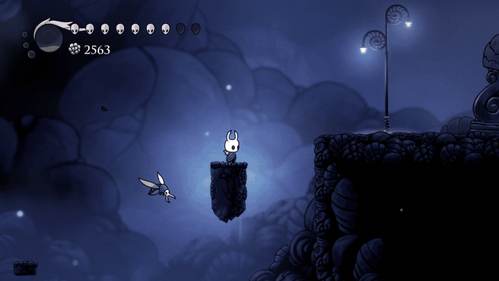

# Unsteady Body

Steady Body keeps the Knight planted while they swing their nail. Turn it over,
and it does the opposite.

## What happens

Steady Body has a second side. You buy it from Salubra as usual, and it works
exactly like Steady Body. Turn it over at a bench and it becomes **Unsteady
Body**, with its own name, description and icon: Steady Body's, upside down and
sky blue.

**To turn it over:** sit at a bench, open the charm menu, select the charm and
press the **Dream Nail** button. The prompt reads "Destabilize" on the Steady
side and "Stabilize" on the Unsteady side. Each save file
remembers which way up it is.

While Unsteady Body is equipped:

- **Every nail strike throws them backwards**, on the ground or in the air, and
  a long way.
- **Striking downwards launches them skywards** instead of the usual small pogo
  bounce. They stop if they hit a ceiling.
- **Striking upwards in the air drops them like a stone.**
- **When they fly off screen**, a bubble at the edge shows them live, with an
  arrow pointing to where they are. The farther they go, the smaller it gets.

Steady side up, or not equipped, the game plays as normal.

### Things to know

- **Bouncy mushrooms launch them too.** In the Fungal Wastes, just touching
  one sends them flying. This is intended.
- **Striking hazards counts.** Hitting spikes, thorns or vines with the nail
  launches them just like hitting an enemy, even where you couldn't normally
  pogo. Some areas get much harder, and a few may be impossible with the
  charm on.
- **If you're stuck,** Save & Quit and load the save. You'll be back at your
  last bench, where you can turn the charm back over or take it off.

## Randomizer

Works with Randomizer 4 and anything else built on ItemChanger, wherever the
charm ends up. It's found steady side up, like Salubra's, and its description
hints at the other side. ItemChanger isn't required.

Randomizer logic doesn't account for launches! Expect to reach places far out of logic using the Unsteady Body charm. If a section gets awkward, flip the charm back over at a bench.

## Installation

Install with **Lumafly**: search for Unsteady Body and click Install. Lumafly
also sets up the Modding API, which this mod needs (Hollow Knight 1.5).

To install by hand, download `UnsteadyBody.zip` from the
[latest release](../../releases/latest) and extract it into
`hollow_knight_Data/Managed/Mods/Unsteady Body/`.

## Options

In the game, go to **Options > Mods > Unsteady Body**.

| Option | What it does |
|---|---|
| Launch strength | Wobbly, Comical (default), Absurd or Ludicrous. |
| Speed limit | On (default), or off at 2x or 4x speed. Same distance in less time. With the limit off they may pass straight through thin walls and platforms. |
| Pogo launch | Whether downward strikes send them skywards. |
| Upward slam | Whether upward strikes in the air drop them. |
| Carry momentum | Experimental, off by default. A launch that's still going when they leave a room continues into the next one. Can skip room triggers such as boss-arena locks. |
| Detailed logging | Off by default. Writes step-by-step details to `ModLog.txt`; turn it on when reporting a bug. |

## Languages

The charm's text and its menu prompt follow the game's language setting:
English, French, German, Spanish, Italian, Brazilian Portuguese, Russian,
Simplified Chinese, Japanese and Korean. The translations haven't been checked
by native speakers yet, so if something reads oddly in your language,
corrections are very welcome: every line is in `Strings.cs`. The mod's options
menu stays in English, like the Modding API's own menus.

## Reporting bugs

Turn on **Detailed logging**, reproduce the problem, then open an issue with
`ModLog.txt` attached (it's in the game's save folder) and a short video if
you can.

## Building from source

See [DEVELOPING.md](DEVELOPING.md).

## How it works

The base game skips sideways recoil whenever charm 14 is worn; that check is
all Steady Body does. With the charm worn Unsteady side up, this mod lets the
recoil through and raises the Knight's own recoil and pogo values (speed and
duration). Otherwise, the original values are put back.

## Credits

Made by TCM, inspired by a name suggestion for [Stumble](https://github.com/BShadid/HKStumbleMod).
Written with an AI assistant's help.

The charm icon (`Resources/UnsteadyBody.png`) is Hollow Knight's Steady Body
icon, turned upside down and recoloured. The original art belongs to Team
Cherry and isn't covered by this repository's MIT licence, which applies to
the code.
